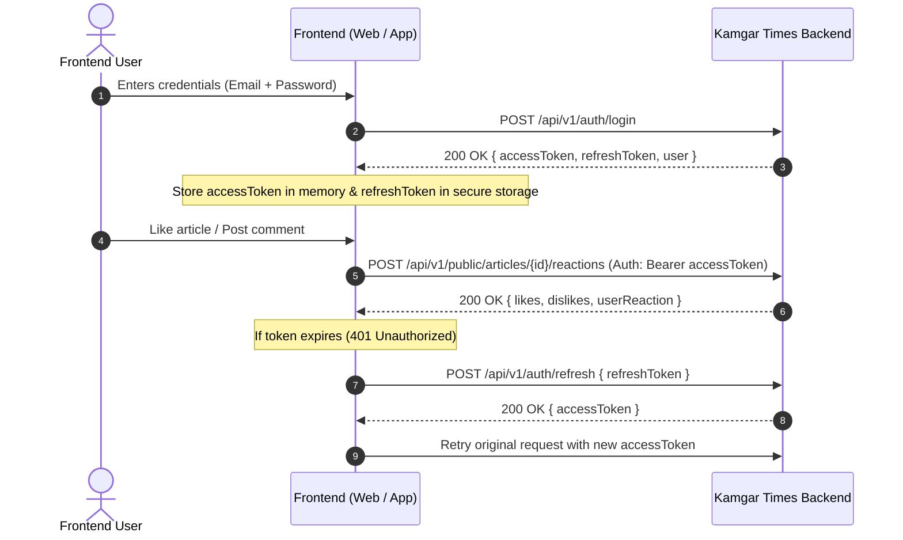

# Kamgar Times — Public API Documentation for Frontend Integration

> **Target Audience:** Frontend Engineers (Web - Next.js / React, Mobile - React Native / Expo)  
> **Base URL:** `http://localhost:5000/api/v1` (Development) / `https://api.kamgartimes.in/api/v1` (Production)  
> **API Version:** `v1`  
> **Content-Type:** `application/json` (unless uploading files with `multipart/form-data`)  

---

## Table of Contents
1. [Architecture & Base URL](#1-architecture--base-url)
2. [Standard Response & Error Envelope](#2-standard-response--error-envelope)
3. [Authentication & Token Handling](#3-authentication--token-handling)
4. [Public Endpoints Specification](#4-public-endpoints-specification)
   - [4.1 Health Check](#41-health-check)
   - [4.2 Authentication APIs](#42-authentication-apis)
   - [4.3 Public Articles (Feed, Detail, Views, Shares, Reactions, Comments)](#43-public-articles)
   - [4.4 Categories & Navigation](#44-categories--navigation)
   - [4.5 Public Advertisements & Click Tracking](#45-public-advertisements--click-tracking)
   - [4.6 Media & Video Library](#46-media--video-library)
   - [4.7 Photo Gallery](#47-photo-gallery)
   - [4.8 Breaking News & Notice Ticker](#48-breaking-news--notice-ticker)
   - [4.9 Question of the Day (QOTD)](#49-question-of-the-day-qotd)
   - [4.10 Site Settings & Branding](#410-site-settings--branding)
   - [4.11 Static Pages (About, Privacy, Terms)](#411-static-pages)
5. [TypeScript Interfaces & Data Types](#5-typescript-interfaces--data-types)
6. [Ready-to-use Frontend API Client (Drop-in Code)](#6-ready-to-use-frontend-api-client)
7. [Rate Limiting, CORS & Error Handling Guidelines](#7-rate-limiting-cors--error-handling-guidelines)
8. [Frontend Developer Integration Checklist](#8-frontend-developer-integration-checklist)

---

## 1. Architecture & Base URL

All endpoints are mounted under the `/api/v1` path prefix.

| Environment | Base URL |
| :--- | :--- |
| **Local Development** | `http://localhost:5000/api/v1` |
| **Staging** | `https://staging-api.kamgartimes.in/api/v1` |
| **Production** | `https://api.kamgartimes.in/api/v1` |

### General Rules:
- **Public Read Access:** Most reader endpoints (`GET /public/*`, `GET /categories`, `GET /gallery/*`, `GET /health`) do **NOT** require an `Authorization` header.
- **Authenticated Reader Actions:** User actions (submitting comments, liking/disliking articles, checking user profile) require a Bearer token:
  ```http
  Authorization: Bearer <accessToken>
  ```
- **Date Format:** All timestamps returned by the API are ISO 8601 UTC strings (e.g. `2026-10-22T14:30:00.000Z`).

---

## 2. Standard Response & Error Envelope

Every API response adheres to a consistent JSON structure.

### 2.1 Success Response (`200 OK` / `201 Created`)
```json
{
  "success": true,
  "statusCode": 200,
  "message": "Articles fetched successfully",
  "data": {
    "articles": [],
    "total": 45,
    "page": 1,
    "limit": 10
  }
}
```

### 2.2 Error Response (`400`, `401`, `403`, `404`, `429`, `500`)
```json
{
  "success": false,
  "statusCode": 400,
  "message": "Validation failed",
  "errors": [
    "email must be a valid email address",
    "password must be at least 8 characters long"
  ]
}
```

### HTTP Status Codes:
- `200 OK`: Request succeeded.
- `201 Created`: Resource successfully created.
- `400 Bad Request`: Validation failure or missing required fields.
- `401 Unauthorized`: Missing, expired, or invalid token.
- `403 Forbidden`: Account deactivated or action not permitted.
- `404 Not Found`: Resource does not exist or has been unpublished.
- `429 Too Many Requests`: Rate limit exceeded.
- `500 Internal Server Error`: Backend error.

---

## 3. Authentication & Token Handling

The authentication system issues **JSON Web Tokens (JWT)**:
- **Access Token:** Short-lived (valid for 1 hour). Pass in header `Authorization: Bearer <token>`.
- **Refresh Token:** Long-lived. Used to retrieve a fresh access token without forcing the user to log in again.



---

## 4. Public Endpoints Specification

### 4.1 Health Check

#### Server Status
Check if the backend API service is running.
- **Method:** `GET`
- **URL:** `/health`
- **Auth:** Not required
- **Response `200 OK`:**
  ```json
  {
    "success": true,
    "message": "Kamagar Times API is running"
  }
  ```

---

### 4.2 Authentication APIs

#### 4.2.1 Register New Reader
- **Method:** `POST`
- **URL:** `/auth/register`
- **Auth:** Not required
- **Request Body:**
  | Field | Type | Required | Description |
  | :--- | :--- | :--- | :--- |
  | `name` | `string` | Yes | Reader full name |
  | `email` | `string` | Yes | Valid email address |
  | `password` | `string` | Yes | Password (minimum 8 characters) |

  ```json
  {
    "name": "Amit Deshmukh",
    "email": "amit@example.com",
    "password": "SecurePassword123"
  }
  ```
- **Response `201 Created`:**
  ```json
  {
    "success": true,
    "statusCode": 201,
    "message": "User registered successfully",
    "data": {
      "id": "6717a6a42a5c3d1e2f3a4b5c",
      "name": "Amit Deshmukh",
      "email": "amit@example.com",
      "role": "user"
    }
  }
  ```

#### 4.2.2 Login Reader
- **Method:** `POST`
- **URL:** `/auth/login`
- **Auth:** Not required
- **Request Body:**
  ```json
  {
    "email": "amit@example.com",
    "password": "SecurePassword123"
  }
  ```
- **Response `200 OK`:**
  ```json
  {
    "success": true,
    "statusCode": 200,
    "message": "Login successful",
    "data": {
      "accessToken": "eyJhbGciOiJIUzI1NiIsIn...",
      "refreshToken": "eyJhbGciOiJIUzI1NiIsIn...",
      "user": {
        "id": "6717a6a42a5c3d1e2f3a4b5c",
        "name": "Amit Deshmukh",
        "email": "amit@example.com",
        "role": "user",
        "permissions": ["article:read", "comment:read", "comment:create"]
      }
    }
  }
  ```

#### 4.2.3 Refresh Access Token
- **Method:** `POST`
- **URL:** `/auth/refresh`
- **Auth:** Not required
- **Request Body:**
  ```json
  {
    "refreshToken": "eyJhbGciOiJIUzI1NiIsIn..."
  }
  ```
- **Response `200 OK`:**
  ```json
  {
    "success": true,
    "statusCode": 200,
    "message": "Access token refreshed",
    "data": {
      "accessToken": "eyJhbGciOiJIUzI1NiIsIn..."
    }
  }
  ```

#### 4.2.4 Get Current User Profile
- **Method:** `GET`
- **URL:** `/auth/me`
- **Auth:** Bearer Token required
- **Response `200 OK`:**
  ```json
  {
    "success": true,
    "statusCode": 200,
    "data": {
      "id": "6717a6a42a5c3d1e2f3a4b5c",
      "name": "Amit Deshmukh",
      "email": "amit@example.com",
      "role": "user",
      "isActive": true
    }
  }
  ```

---

### 4.3 Public Articles

Base path: `/public/articles`

#### 4.3.1 List Published Articles (News Feed)
Fetch published news articles with pagination, category filter, and search.

- **Method:** `GET`
- **URL:** `/public/articles`
- **Auth:** Not required
- **Query Parameters:**
  | Parameter | Type | Required | Default | Description |
  | :--- | :--- | :--- | :--- | :--- |
  | `category` | `string` | No | — | Category ObjectId or category slug |
  | `search` | `string` | No | — | Search keyword (matches in title / summary) |
  | `page` | `number` | No | `1` | Page number |
  | `limit` | `number` | No | `10` | Items per page |

- **Response `200 OK`:**
  ```json
  {
    "success": true,
    "statusCode": 200,
    "message": "Articles fetched successfully",
    "data": {
      "articles": [
        {
          "_id": "6718bc110a2f4a123456789a",
          "title": "मुंबई-पुणे एक्सप्रेसवेवर नवीन सुरक्षा नियम लागू",
          "slug": "mumbai-pune-expressway-new-safety-rules",
          "summary": "वाहतूक कोंडी आणि अपघात रोखण्यासाठी प्रशासनाने नवीन नियमावली जाहीर केली.",
          "featuredImage": "https://res.cloudinary.com/kamgartimes/image/upload/v1/news/expressway.jpg",
          "category": {
            "_id": "6718a1000a2f4a1234567801",
            "name": "महाराष्ट्र",
            "slug": "maharashtra"
          },
          "author": {
            "name": "कामगार टाईम्स डेस्क"
          },
          "views": 1420,
          "shares": 85,
          "publishedAt": "2026-10-22T10:00:00.000Z",
          "readTime": 4
        }
      ],
      "total": 128,
      "page": 1,
      "limit": 10
    }
  }
  ```
> **Frontend Tip:** The feed response intentionally excludes the full article HTML body to keep payload sizes small. Use detail endpoint (4.3.2) on the article page.

---

#### 4.3.2 Get Full Article by Slug
Fetch detailed content for the single article reader page.

- **Method:** `GET`
- **URL:** `/public/articles/{slug}`
- **Auth:** Not required
- **Path Parameter:** `slug` (e.g. `mumbai-pune-expressway-new-safety-rules`)
- **Response `200 OK`:**
  ```json
  {
    "success": true,
    "statusCode": 200,
    "message": "Article fetched successfully",
    "data": {
      "_id": "6718bc110a2f4a123456789a",
      "title": "मुंबई-पुणे एक्सप्रेसवेवर नवीन सुरक्षा नियम लागू",
      "slug": "mumbai-pune-expressway-new-safety-rules",
      "summary": "वाहतूक कोंडी आणि अपघात रोखण्यासाठी प्रशासनाने नवीन नियमावली जाहीर केली.",
      "content": "<p>महाराष्ट्र राज्य रस्ते विकास महामंडळाने नवीन मार्गदर्शक तत्त्वे जारी केली आहेत...</p>",
      "featuredImage": "https://res.cloudinary.com/kamgartimes/image/upload/v1/news/expressway.jpg",
      "featuredImageAlt": "मुंबई-पुणे एक्सप्रेसवे",
      "category": {
        "_id": "6718a1000a2f4a1234567801",
        "name": "महाराष्ट्र",
        "slug": "maharashtra"
      },
      "tags": ["महाराष्ट्र", "वाहतूक", "पुणे", "मुंबई"],
      "author": {
        "_id": "6717a6a42a5c3d1e2f3a4b00",
        "name": "राजेश पाटील",
        "avatar": "https://res.cloudinary.com/kamgartimes/image/upload/v1/avatars/rajesh.jpg"
      },
      "views": 1421,
      "shares": 85,
      "likes": 230,
      "dislikes": 8,
      "publishedAt": "2026-10-22T10:00:00.000Z",
      "readTime": 4
    }
  }
  ```
- **Response `404 Not Found`:** If slug is not found or article is still in draft/archived status.

---

#### 4.3.3 Record Article View Count
Increment the article view counter when a user opens the article. Call this once when the reader page mounts.

- **Method:** `POST`
- **URL:** `/public/articles/{id}/view`
- **Auth:** Not required
- **Response `200 OK`:**
  ```json
  {
    "success": true,
    "statusCode": 200,
    "message": "View recorded",
    "data": {
      "views": 1422
    }
  }
  ```

---

#### 4.3.4 Record Article Share Count
Call when the user clicks WhatsApp, Twitter, Facebook, or Copy Link buttons.

- **Method:** `POST`
- **URL:** `/public/articles/{id}/share`
- **Auth:** Not required
- **Response `200 OK`:**
  ```json
  {
    "success": true,
    "statusCode": 200,
    "message": "Share recorded",
    "data": {
      "shares": 86
    }
  }
  ```

---

#### 4.3.5 Record Article Outbound Link Click
- **Method:** `POST`
- **URL:** `/public/articles/{id}/clicks`
- **Auth:** Not required
- **Response `200 OK`:**
  ```json
  {
    "success": true,
    "statusCode": 200,
    "message": "Link click recorded",
    "data": {
      "clicks": 14
    }
  }
  ```

---

#### 4.3.6 Get Article Reactions
Returns total like/dislike counts, plus the current user's reaction if authenticated.

- **Method:** `GET`
- **URL:** `/public/articles/{id}/reactions`
- **Auth:** Optional (Include Bearer token if reader is logged in)
- **Response `200 OK`:**
  ```json
  {
    "success": true,
    "statusCode": 200,
    "message": "Reactions fetched successfully",
    "data": {
      "likes": 230,
      "dislikes": 8,
      "userReaction": "LIKE"
    }
  }
  ```
  *(If user is guest or has not reacted, `userReaction` will be `null`)*

---

#### 4.3.7 Toggle Like / Dislike Reaction
Toggle reader like/dislike. If the user clicks `LIKE` while already liked, it removes the reaction.

- **Method:** `POST`
- **URL:** `/public/articles/{id}/reactions`
- **Auth:** Bearer Token required
- **Request Body:**
  ```json
  {
    "type": "LIKE"
  }
  ```
  *(Allowed values: `"LIKE"` or `"DISLIKE"`)*
- **Response `200 OK`:**
  ```json
  {
    "success": true,
    "statusCode": 200,
    "message": "Reaction updated successfully",
    "data": {
      "likes": 231,
      "dislikes": 8,
      "userReaction": "LIKE"
    }
  }
  ```

---

#### 4.3.8 List Article Comments
Fetch approved public comments for an article.

- **Method:** `GET`
- **URL:** `/public/articles/{id}/comments`
- **Auth:** Not required
- **Query Parameters:** `page` (default 1), `limit` (default 20)
- **Response `200 OK`:**
  ```json
  {
    "success": true,
    "statusCode": 200,
    "message": "Comments fetched successfully",
    "data": {
      "comments": [
        {
          "_id": "6718d0010a2f4a1234567999",
          "body": "खूप माहितीपूर्ण लेख आहे. धन्यवाद!",
          "author": {
            "_id": "6717a6a42a5c3d1e2f3a4b5c",
            "name": "Amit Deshmukh"
          },
          "createdAt": "2026-10-22T11:20:00.000Z",
          "replies": []
        }
      ],
      "total": 1,
      "page": 1,
      "limit": 20
    }
  }
  ```

---

#### 4.3.9 Post Article Comment
- **Method:** `POST`
- **URL:** `/public/articles/{id}/comments`
- **Auth:** Bearer Token required
- **Request Body:**
  | Field | Type | Required | Description |
  | :--- | :--- | :--- | :--- |
  | `body` | `string` | Yes | Comment text (1 to 2000 characters) |
  | `parent` | `string` | No | Parent comment `_id` if replying to a thread |

  ```json
  {
    "body": "या निर्णयाचे स्वागत आहे. यामुळे वाहतूक सुरळीत होईल.",
    "parent": null
  }
  ```
- **Response `201 Created`:**
  ```json
  {
    "success": true,
    "statusCode": 201,
    "message": "Comment submitted successfully",
    "data": {
      "_id": "6718d0010a2f4a1234567999",
      "body": "या निर्णयाचे स्वागत आहे. यामुळे वाहतूक सुरळीत होईल.",
      "author": "Amit Deshmukh",
      "createdAt": "2026-10-22T11:20:00.000Z"
    }
  }
  ```

---

### 4.4 Categories & Navigation

Base path: `/categories`

#### 4.4.1 List All Active Categories
Fetch category list for header navigation menus, category tabs, or filters.

- **Method:** `GET`
- **URL:** `/categories?isActive=true`
- **Auth:** Not required
- **Response `200 OK`:**
  ```json
  {
    "success": true,
    "statusCode": 200,
    "data": {
      "categories": [
        {
          "_id": "6718a1000a2f4a1234567801",
          "name": "महाराष्ट्र",
          "slug": "maharashtra",
          "isActive": true
        },
        {
          "_id": "6718a1000a2f4a1234567802",
          "name": "कामगार विश्व",
          "slug": "kamgar-vishwa",
          "isActive": true
        },
        {
          "_id": "6718a1000a2f4a1234567803",
          "name": "राष्ट्रीय",
          "slug": "national",
          "isActive": true
        }
      ],
      "total": 3
    }
  }
  ```

#### 4.4.2 Category Tree (Hierarchical)
- **Method:** `GET`
- **URL:** `/categories/tree`
- **Auth:** Not required
- **Response `200 OK`:** Returns categories with nested `children` arrays for multi-level navigation menus.

---

### 4.5 Public Advertisements & Click Tracking

Base path: `/public/ads`

#### 4.5.1 Fetch Ads for Placement Slot
Used by frontend ad banners to fetch active campaigns assigned to a specific slot key.

- **Method:** `GET`
- **URL:** `/public/ads?slot={slot_key}`
- **Auth:** Not required
- **Query Parameter:** `slot` (Required - string)
- **Standard Ad Slot Keys:**
  | Slot Key | Typical Dimensions | Placement Description |
  | :--- | :--- | :--- |
  | `hero_leaderboard` | 970 × 250 px | Top banner directly under main header |
  | `article_top` | 728 × 90 px | Above the article title / headline |
  | `article_mid_content` | 300 × 250 px | Embedded inside paragraph content |
  | `sidebar_square` | 300 × 250 px | Right-hand side sticky sidebar |
  | `footer_sticky` | 320 × 50 px / 728 × 90 px | Mobile / Desktop bottom sticky banner |

- **Example Request:**
  `GET /api/v1/public/ads?slot=hero_leaderboard`
- **Response `200 OK`:**
  ```json
  {
    "success": true,
    "statusCode": 200,
    "message": "Ads fetched successfully",
    "data": {
      "slot": {
        "_id": "6718f0010a2f4a1234567111",
        "key": "hero_leaderboard",
        "name": "Hero Top Banner",
        "size": {
          "width": 970,
          "height": 250
        }
      },
      "ads": [
        {
          "campaignId": "6718f0010a2f4a1234567222",
          "slotId": "6718f0010a2f4a1234567111",
          "title": "दिवाळी विशेष सवलत",
          "image": "https://res.cloudinary.com/kamgartimes/image/upload/v1/ads/diwali-banner.jpg",
          "imageAlt": "Diwali Offer Banner",
          "clickUrl": "https://example.com/diwali-offer",
          "target": "_blank",
          "priority": 10
        }
      ]
    }
  }
  ```

#### 4.5.2 Track Ad Click & Redirect
When a user clicks on an ad banner, frontend calls this endpoint to record analytics. The backend returns the destination URL.

- **Method:** `POST`
- **URL:** `/public/ads/click`
- **Auth:** Not required
- **Rate Limit:** 30 clicks / minute per IP
- **Request Body:**
  ```json
  {
    "adCampaignId": "6718f0010a2f4a1234567222",
    "adSlotId": "6718f0010a2f4a1234567111"
  }
  ```
- **Response `200 OK`:**
  ```json
  {
    "success": true,
    "statusCode": 200,
    "message": "Click recorded",
    "data": {
      "clickUrl": "https://example.com/diwali-offer",
      "target": "_blank"
    }
  }
  ```

---

### 4.6 Media & Video Library

#### 4.6.1 List Published Images
- **Method:** `GET`
- **URL:** `/public/media/images`
- **Query Parameters:** `page`, `limit`, `search`
- **Response `200 OK`:**
  ```json
  {
    "success": true,
    "statusCode": 200,
    "data": {
      "images": [
        {
          "_id": "671900010a2f4a1234567333",
          "title": "कामगार मेळावा आझाद मैदान",
          "url": "https://res.cloudinary.com/kamgartimes/image/upload/v1/media/rally.jpg",
          "altText": "कामगार मेळावा"
        }
      ],
      "total": 50,
      "page": 1,
      "limit": 20
    }
  }
  ```

#### 4.6.2 List Published Videos
Supports YouTube videos and Shorts with pre-computed embed URLs and thumbnails.

- **Method:** `GET`
- **URL:** `/public/media/videos`
- **Query Parameters:**
  | Parameter | Type | Values | Description |
  | :--- | :--- | :--- | :--- |
  | `videoType` | `string` | `VIDEO` / `SHORT` | Filter regular videos or YouTube shorts |
  | `category` | `string` | ObjectId | Category filter |
  | `page` | `number` | Default 1 | Page number |
  | `limit` | `number` | Default 20 | Page size |

- **Response `200 OK`:**
  ```json
  {
    "success": true,
    "statusCode": 200,
    "data": {
      "videos": [
        {
          "_id": "671910010a2f4a1234567444",
          "title": "कामगार संघटना प्रतिनिधींशी विशेष संवाद",
          "youtubeUrl": "https://www.youtube.com/watch?v=dQw4w9WgXcQ",
          "embedUrl": "https://www.youtube.com/embed/dQw4w9WgXcQ",
          "thumbnailUrl": "https://img.youtube.com/vi/dQw4w9WgXcQ/hqdefault.jpg",
          "videoType": "VIDEO",
          "status": "PUBLISHED"
        }
      ],
      "total": 12,
      "page": 1,
      "limit": 20
    }
  }
  ```

---

### 4.7 Photo Gallery

Base path: `/gallery`

#### 4.7.1 Featured Gallery Items (Homepage Carousel)
- **Method:** `GET`
- **URL:** `/gallery/home`
- **Auth:** Not required
- **Response `200 OK`:**
  ```json
  {
    "success": true,
    "statusCode": 200,
    "data": [
      {
        "_id": "671920010a2f4a1234567555",
        "title": "मुंबई कामगार दिन सोहळा",
        "imageUrl": "https://res.cloudinary.com/kamgartimes/image/upload/v1/gallery/worker-day.jpg",
        "caption": "कामगार दिनानिमित्त भव्य रॅलीचे आयोजन.",
        "isHomeFeatured": true
      }
    ]
  }
  ```

#### 4.7.2 All Gallery Items (Photo Gallery Page)
- **Method:** `GET`
- **URL:** `/gallery`
- **Query Parameters:** `page`, `limit`

---

### 4.8 Breaking News & Notice Ticker

Base path: `/public/notices`

#### 4.8.1 Fetch Notice Ticker
Fetch active breaking news updates and high-priority notices for the scrolling top ticker bar.

- **Method:** `GET`
- **URL:** `/public/notices/ticker`
- **Auth:** Not required
- **Response `200 OK`:**
  ```json
  {
    "success": true,
    "statusCode": 200,
    "message": "Notice ticker fetched successfully",
    "data": [
      {
        "_id": "671930010a2f4a1234567666",
        "title": "दिवाळी बोनस संदर्भात शासनाचा मोठा निर्णय",
        "message": "सर्व कंत्राटी कर्मचाऱ्यांना यंदा 15 टक्के बोनस जाहीर.",
        "linkUrl": "/news/diwali-bonus-government-decision",
        "linkText": "अधिक वाचा",
        "priority": 10
      }
    ]
  }
  ```

---

### 4.9 Question of the Day (QOTD)

Base path: `/public/question-of-the-day`

#### 4.9.1 Get Today's Active Question
Returns today's poll question and options. Correct answer and explanation are hidden from public read.

- **Method:** `GET`
- **URL:** `/public/question-of-the-day`
- **Auth:** Not required
- **Query Parameter:** `category` (optional)
- **Response `200 OK`:**
  ```json
  {
    "success": true,
    "statusCode": 200,
    "message": "Today's question of the day fetched successfully",
    "data": {
      "_id": "671940010a2f4a1234567777",
      "question": "भारतात किमान वेतन कायदा कोणत्या वर्षी संमत करण्यात आला?",
      "options": [
        "1947",
        "1948",
        "1950",
        "1952"
      ],
      "category": "कामगार कायदे",
      "startDate": "2026-10-22T00:00:00.000Z",
      "endDate": "2026-10-22T23:59:59.000Z"
    }
  }
  ```
- **Response `404 Not Found`:** If no active question is scheduled for today.

#### 4.9.2 Submit & Check Answer
Submits reader's answer to verify correctness and reveals the explanation.

- **Method:** `POST`
- **URL:** `/public/question-of-the-day/check`
- **Auth:** Not required
- **Request Body:**
  ```json
  {
    "answer": "1948",
    "category": "कामगार कायदे"
  }
  ```
- **Response `200 OK`:**
  ```json
  {
    "success": true,
    "statusCode": 200,
    "message": "Answer checked successfully",
    "data": {
      "correct": true,
      "correctAnswer": "1948",
      "explanation": "किमान वेतन कायदा (Minimum Wages Act) 1948 मध्ये संमत करण्यात आला होता."
    }
  }
  ```

---

### 4.10 Site Settings & Branding

Singleton configuration providing website branding, contact info, maintenance mode, and social media channels.

- **Method:** `GET`
- **URL:** `/public/site-setting` (or `/site-setting`)
- **Auth:** Not required
- **Response `200 OK`:**
  ```json
  {
    "success": true,
    "statusCode": 200,
    "message": "Site setting fetched successfully",
    "data": {
      "_id": "671950010a2f4a1234567888",
      "siteName": "कामगार टाईम्स",
      "tagline": "कामगारांचा बुलंद आवाज",
      "logoUrl": "https://res.cloudinary.com/kamgartimes/image/upload/v1/branding/logo.png",
      "contactEmail": "editor@kamgartimes.in",
      "contactPhone": "+91 22 2456 7890",
      "address": "दादर, मुंबई, महाराष्ट्र - 400028",
      "isMaintenanceMode": false,
      "socialLinks": [
        {
          "platform": "whatsapp",
          "url": "https://chat.whatsapp.com/kamgartimes"
        },
        {
          "platform": "youtube",
          "url": "https://youtube.com/@kamgartimes"
        },
        {
          "platform": "facebook",
          "url": "https://facebook.com/kamgartimes"
        },
        {
          "platform": "twitter",
          "url": "https://twitter.com/kamgartimes"
        }
      ]
    }
  }
  ```

---

### 4.11 Static Pages

Base path: `/public/static-pages`

Fetch pages like About Us, Privacy Policy, Terms & Conditions by slug.

- **Method:** `GET`
- **URL:** `/public/static-pages/{slug}`
- **Auth:** Not required
- **Common Slugs:** `about-us`, `privacy-policy`, `terms-and-conditions`, `disclaimer`, `contact-us`
- **Response `200 OK`:**
  ```json
  {
    "success": true,
    "statusCode": 200,
    "message": "Static page fetched successfully",
    "data": {
      "_id": "671960010a2f4a1234567999",
      "title": "आमच्याबद्दल (About Us)",
      "slug": "about-us",
      "content": "<h2>कामगार टाईम्स बद्दल</h2><p>कामगार टाईम्स हे महाराष्ट्रातील आघाडीचे कामगार व जनहित वृत्तपत्र आहे...</p>",
      "excerpt": "कामगार आणि कष्टकरी जनतेचा आवाज बनणारे व्यासपीठ.",
      "showInFooter": true,
      "sortOrder": 1,
      "publishedAt": "2026-10-22T00:00:00.000Z"
    }
  }
  ```
- **Response `404 Not Found`:** If page is not found or is marked inactive.

---

## 5. TypeScript Interfaces & Data Types

Save this file as `src/types/api.ts` in your frontend project:

```typescript
// ==================== Common API Envelope ====================
export interface ApiResponse<T> {
  success: boolean;
  statusCode?: number;
  message: string;
  data: T;
  errors?: string[];
}

// ==================== Auth & User ====================
export interface UserProfile {
  id: string;
  name: string;
  email: string;
  role: 'admin' | 'editor' | 'reporter' | 'user';
  permissions?: string[];
  isActive?: boolean;
}

export interface AuthResponse {
  accessToken: string;
  refreshToken?: string;
  user: UserProfile;
}

// ==================== Categories ====================
export interface Category {
  _id: string;
  name: string;
  slug: string;
  description?: string;
  parent?: string | null;
  isActive: boolean;
  children?: Category[];
}

// ==================== Articles ====================
export interface ArticleAuthor {
  _id?: string;
  name: string;
  avatar?: string;
}

export interface ArticleListItem {
  _id: string;
  title: string;
  slug: string;
  summary: string;
  featuredImage: string;
  category: Pick<Category, '_id' | 'name' | 'slug'>;
  author: ArticleAuthor;
  views: number;
  shares: number;
  publishedAt: string;
  readTime: number;
}

export interface ArticleDetail extends ArticleListItem {
  content: string; // HTML markup
  featuredImageAlt?: string;
  tags?: string[];
  likes: number;
  dislikes: number;
}

export interface ArticleReactions {
  likes: number;
  dislikes: number;
  userReaction: 'LIKE' | 'DISLIKE' | null;
}

export interface ArticleComment {
  _id: string;
  body: string;
  author: {
    _id: string;
    name: string;
  };
  createdAt: string;
  replies?: ArticleComment[];
}

// ==================== Advertisements ====================
export interface AdSlot {
  _id: string;
  key: string;
  name: string;
  size: {
    width: number;
    height: number;
  };
}

export interface PublicAd {
  campaignId: string;
  slotId: string;
  title: string;
  image: string;
  imageAlt?: string;
  clickUrl: string;
  target?: '_blank' | '_self';
  priority?: number;
}

export interface AdSlotResponse {
  slot: AdSlot;
  ads: PublicAd[];
}

// ==================== Ticker & Notices ====================
export interface NoticeTickerItem {
  _id: string;
  title: string;
  message: string;
  linkUrl?: string;
  linkText?: string;
  priority: number;
}

// ==================== Question of the Day ====================
export interface QotdQuestion {
  _id: string;
  question: string;
  options: string[];
  category?: string;
  startDate: string;
  endDate: string;
}

export interface QotdAnswerResult {
  correct: boolean;
  correctAnswer: string;
  explanation: string;
}

// ==================== Site Settings ====================
export interface SocialLink {
  platform: 'whatsapp' | 'youtube' | 'facebook' | 'instagram' | 'twitter';
  url: string;
}

export interface SiteSettings {
  _id: string;
  siteName: string;
  tagline: string;
  logoUrl?: string;
  contactEmail: string;
  contactPhone: string;
  address: string;
  isMaintenanceMode: boolean;
  socialLinks: SocialLink[];
}

// ==================== Static Pages ====================
export interface StaticPage {
  _id: string;
  title: string;
  slug: string;
  content: string;
  excerpt?: string;
  showInFooter: boolean;
  sortOrder: number;
  publishedAt: string;
}
```

---

## 6. Ready-to-use Frontend API Client

Drop this client file into your frontend project at `src/services/apiClient.ts` (Next.js, Vite, or React Native):

```typescript
// src/services/apiClient.ts

const API_BASE = (process.env.NEXT_PUBLIC_API_URL || process.env.VITE_API_URL || 'http://localhost:5000/api/v1').replace(/\/$/, '');

export class ApiError extends Error {
  statusCode: number;
  errors?: string[];

  constructor(message: string, statusCode: number = 0, errors?: string[]) {
    super(message);
    this.name = 'ApiError';
    this.statusCode = statusCode;
    this.errors = errors;
  }
}

// Token storage helpers (adapt for localStorage or SecureStore in React Native)
const getAuthToken = (): string | null => {
  if (typeof window === 'undefined') return null;
  return localStorage.getItem('kt_access_token');
};

const getRefreshToken = (): string | null => {
  if (typeof window === 'undefined') return null;
  return localStorage.getItem('kt_refresh_token');
};

export const setAuthTokens = (accessToken: string, refreshToken?: string) => {
  if (typeof window === 'undefined') return;
  localStorage.setItem('kt_access_token', accessToken);
  if (refreshToken) localStorage.setItem('kt_refresh_token', refreshToken);
};

export const clearAuthTokens = () => {
  if (typeof window === 'undefined') return;
  localStorage.removeItem('kt_access_token');
  localStorage.removeItem('kt_refresh_token');
};

// Auto-refresh token locking mechanism
let refreshPromise: Promise<boolean> | null = null;

async function refreshAccessToken(): Promise<boolean> {
  const refreshToken = getRefreshToken();
  if (!refreshToken) return false;

  try {
    const res = await fetch(`${API_BASE}/auth/refresh`, {
      method: 'POST',
      headers: { 'Content-Type': 'application/json' },
      body: JSON.stringify({ refreshToken }),
    });

    if (!res.ok) return false;

    const data = await res.json();
    const newAccessToken = data?.data?.accessToken;
    if (newAccessToken) {
      setAuthTokens(newAccessToken);
      return true;
    }
    return false;
  } catch {
    return false;
  }
}

export async function request<T>(
  endpoint: string,
  options: RequestInit & { requiresAuth?: boolean; _retry?: boolean } = {}
): Promise<T> {
  const { requiresAuth = false, _retry = false, headers = {}, ...rest } = options;

  const requestHeaders: Record<string, string> = {
    'Content-Type': 'application/json',
    ...(headers as Record<string, string>),
  };

  const token = getAuthToken();
  if (requiresAuth && token) {
    requestHeaders['Authorization'] = `Bearer ${token}`;
  }

  let response: Response;
  try {
    response = await fetch(`${API_BASE}${endpoint}`, {
      ...rest,
      headers: requestHeaders,
    });
  } catch {
    throw new ApiError('Unable to connect to Kamgar Times server. Please check your internet connection.', 0);
  }

  // Token expired handle (401)
  if (response.status === 401 && requiresAuth && !_retry) {
    if (!refreshPromise) {
      refreshPromise = refreshAccessToken().finally(() => {
        refreshPromise = null;
      });
    }

    const refreshed = await refreshPromise;
    if (refreshed) {
      return request<T>(endpoint, { ...options, _retry: true });
    } else {
      clearAuthTokens();
    }
  }

  const json = await response.json().catch(() => null);

  if (!response.ok) {
    const errorMessage = json?.message || 'Something went wrong';
    throw new ApiError(errorMessage, response.status, json?.errors);
  }

  return (json && 'data' in json ? json.data : json) as T;
}

// Convenient HTTP methods
export const api = {
  get: <T>(url: string, requiresAuth = false) =>
    request<T>(url, { method: 'GET', requiresAuth }),

  post: <T>(url: string, body?: any, requiresAuth = false) =>
    request<T>(url, {
      method: 'POST',
      body: body ? JSON.stringify(body) : undefined,
      requiresAuth,
    }),

  put: <T>(url: string, body?: any, requiresAuth = false) =>
    request<T>(url, {
      method: 'PUT',
      body: body ? JSON.stringify(body) : undefined,
      requiresAuth,
    }),

  patch: <T>(url: string, body?: any, requiresAuth = false) =>
    request<T>(url, {
      method: 'PATCH',
      body: body ? JSON.stringify(body) : undefined,
      requiresAuth,
    }),

  delete: <T>(url: string, requiresAuth = false) =>
    request<T>(url, { method: 'DELETE', requiresAuth }),
};
```

---

## 7. Rate Limiting, CORS & Error Handling Guidelines

### 7.1 Rate Limits
| Route Scope | Limit | Duration | Status on Limit |
| :--- | :--- | :--- | :--- |
| **Global API** | 100 requests | 15 minutes / IP | `429 Too Many Requests` |
| **Ad Click Tracking** | 30 requests | 1 minute / IP | `429 Too Many Requests` |

### 7.2 CORS Setup
The backend currently permits requests originating from:
- `http://localhost:3000` (Next.js / React dev server)
- `http://localhost:3001` (Alternative dev port)
- `http://127.0.0.1:3000`
- `http://127.0.0.1:3001`

*For production deployment, coordinate with the backend team to add your production domain to the CORS allowlist in `src/app.js`.*

### 7.3 Frontend Error Handling Example
```typescript
try {
  const result = await api.post('/public/articles/123/comments', { body: 'Nice article' }, true);
  toast.success('Comment published!');
} catch (error) {
  if (error instanceof ApiError) {
    if (error.statusCode === 401) {
      toast.error('Please login to leave a comment.');
      router.push('/login');
    } else if (error.errors && error.errors.length > 0) {
      toast.error(error.errors.join(', '));
    } else {
      toast.error(error.message);
    }
  } else {
    toast.error('An unexpected error occurred.');
  }
}
```

---

## 8. Frontend Developer Integration Checklist

- [ ] **Configure Environment Variable:** Add `NEXT_PUBLIC_API_URL=http://localhost:5000/api/v1` in `.env.local`
- [ ] **Verify Server Connection:** Test with `GET /health` on application boot.
- [ ] **Load Site Settings:** Call `GET /public/site-setting` in the Root Layout to hydrate site logo, social icons, and contact details.
- [ ] **Fetch Navigation Menu:** Call `GET /categories?isActive=true` to render top categories.
- [ ] **Ticker Bar:** Call `GET /public/notices/ticker` to render the breaking news marquee.
- [ ] **Home Page Feeds:** Call `GET /public/articles?limit=10` and `GET /gallery/home` for the hero sliders.
- [ ] **Article Page Integration:**
  - Call `GET /public/articles/:slug` to render article title, author, date, and HTML body.
  - Call `POST /public/articles/:id/view` once on page load.
  - Implement share buttons triggering `POST /public/articles/:id/share`.
  - Fetch reactions via `GET /public/articles/:id/reactions` and hook like button to `POST /public/articles/:id/reactions`.
  - Fetch comments via `GET /public/articles/:id/comments`.
- [ ] **Ad Placements:** Use `GET /public/ads?slot=hero_leaderboard` (and other keys) to render ad banners and bind click handler to `POST /public/ads/click`.
- [ ] **Poll / Question of the Day:** Render question from `GET /public/question-of-the-day` and check answer using `POST /public/question-of-the-day/check`.
- [ ] **Footer Pages:** Render static pages (`about-us`, `privacy-policy`, etc.) dynamically via `GET /public/static-pages/:slug`.
